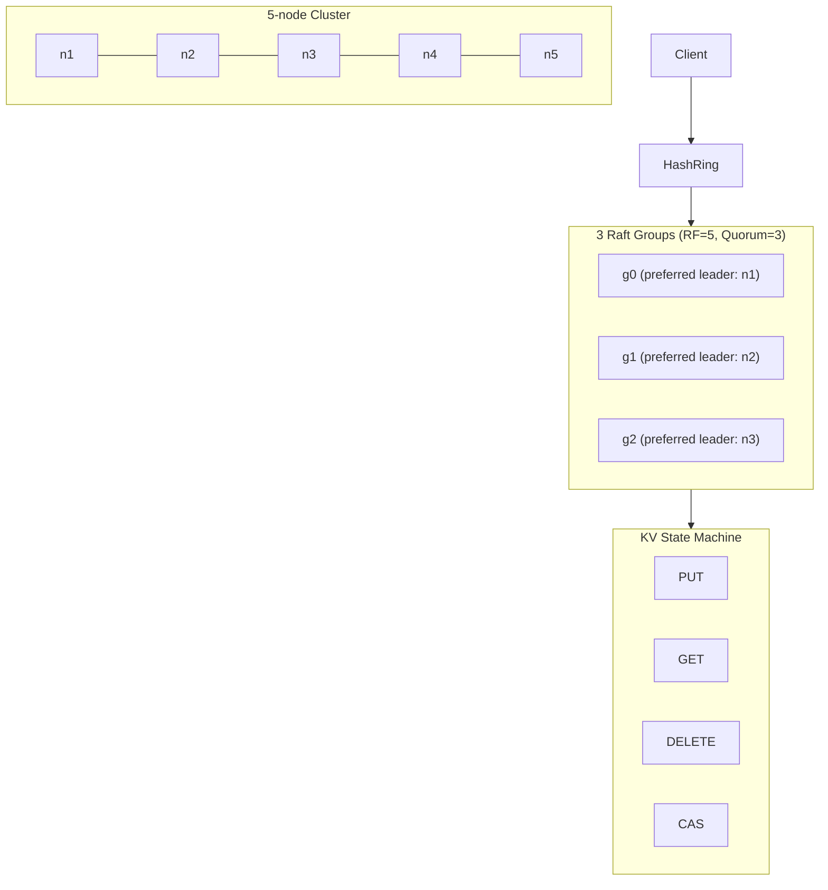

# AegisDB

A fault-tolerant, sharded key-value store built in C++17 using Raft consensus.

> **Status**: Milestones 1–7 complete (foundations, WAL, KV store, Raft with PreVote / CheckQuorum /
> ReadIndex / snapshots, 23-seed chaos suite). Milestone 8 (frame stream) and 9 (HashRing) are
> partly done; the TCP transport, multi-group server and tooling are still to come.

## Architecture



## Build

```bash
# Prerequisites: GCC ≥ 11 or Clang ≥ 14, CMake ≥ 3.20, Ninja
cmake -S . -B build -DCMAKE_BUILD_TYPE=Release
cmake --build build -j$(nproc)
ctest --test-dir build --output-on-failure
```

ASAN / TSAN builds:
```bash
cmake -S . -B build_asan -DCMAKE_BUILD_TYPE=Debug -DAEGIS_ASAN=ON
cmake -S . -B build_tsan -DCMAKE_BUILD_TYPE=Debug -DAEGIS_TSAN=ON
```

## Milestones

| # | Description | Status |
|---|-------------|--------|
| 1 | CMake skeleton, codec, CRC32-C, logger, GoogleTest | ✅ |
| 2 | WAL | ✅ |
| 3 | KvStore | ✅ |
| 4 | Single-group Raft on FakeNetwork | ✅ |
| 5 | Raft hardening (PreVote, CheckQuorum, no-op, fast backtracking, ReadIndex) | ✅ |
| 6 | Snapshots + InstallSnapshot (log compaction, lagging-follower catch-up) | ✅ |
| 7 | ChaosTest (23 seeds: partitions, 10% drops, stale-leader proposals) | ✅ |
| 8 | TCP layer | 🔶 frame stream reassembly done; `TcpServer` / `RpcClient` / `Transport` pending |
| 9 | Multi-group server, HashRing, aegisd, aegisctl | 🔶 `HashRing` done; server, `aegisd`, `aegisctl` pending |
| 10 | ClusterFaultTest | 🔲 |
| 11 | aegis_bench + tuning | 🔲 |
| 12 | Rebalance | 🔲 |
| 13 | Docker, CI, README | 🔲 |

---

*Full architecture diagram, WAL format, test inventory, measured results, design trade-offs, and known limitations will be added in milestone 13.*
