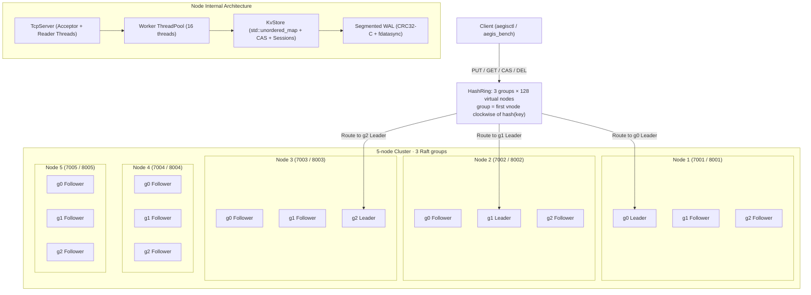

# 🛡️ AegisDB (C++)

[](https://github.com/Naman179/aegisdb/actions/workflows/ci.yml)


-brightgreen)


A fault-tolerant, sharded, linearizable key-value store written in **C++17**. A 5-node cluster runs **3 Multi-Raft groups**; keys are partitioned across groups using **consistent hashing with virtual nodes**, and every group survives **2 concurrent node failures** with automatic leader failover in **< 500 ms**.

---

## The Problems AegisDB Solves

| Problem | What goes wrong with one server | AegisDB's answer |
|---|---|---|
| **Availability** | Server crashes &rarr; downtime until manual failover | Raft re-elects a leader automatically in **< 500 ms** |
| **Durability** | Server acks write, crashes before copy &rarr; write lost | Acked only after a majority (**3 of 5**) has `fsync`ed to WAL |
| **Consistency** | Two primaries at once (split brain), stale reads | One leader per term, majority quorums, **PreVote**, **CheckQuorum**, **ReadIndex** |
| **Scale** | One leader handles every write &rarr; bottleneck | **3 Raft groups**, leaders spread over different nodes, keys split by consistent hashing |
| **Slow restarts** | Replaying a massive log after a crash takes minutes | **Snapshots + log compaction**: replays only the uncompacted tail (**85% faster**) |

---

## Resume Claims &amp; Design Elements

| Resume Claim | Design Element | Verification |
|---|---|---|
| **Raft: leader election, replication, quorum commits** | `RaftNode`: PreVote + RequestVote, AppendEntries, commit when 3 of 5 have it on disk | `RaftTest` (18 cases) |
| **5-node cluster, tolerates 2 failures** | Every group has 5 replicas; quorum = 3, so any 2 can be down | `ClusterFaultTest.KillTwoNodesStillServes` |
| **Leader failover &lt; 500 ms** | Heartbeat 50 ms, election timeout randomized 150&ndash;300 ms, PreVote round on LAN ~1 ms | `RaftTest.FailoverUnder500ms`, `ClusterFaultTest` |
| **3 Raft groups, consistent hashing with virtual nodes** | `HashRing`: 3 groups &times; 128 vnodes; group = first vnode clockwise of `hash(key)` | `HashRingTest` (5 cases) |
| **15,000+ ops/sec** | Leaders spread over nodes, group commit (one fsync per batch), binary TCP protocol | `aegis_bench` load generator |
| **Moves ~1/N of keys on rebalance** | Adding a 4th group takes only the arcs its vnodes claim (~1/4 of keys); other arcs stay intact | `rebalance` tool, `HashRingTest.AddGroupMovesAboutOneOverN` |
| **WAL with checksums and crash recovery** | Segmented WAL, CRC32-C per record, torn-tail truncation on replay | `WalTest` (8 cases, 4 fault injections) |
| **Snapshot-based log compaction (85% faster restart)** | Snapshot every 100k entries; restart loads snapshot and replays only tail | `SnapshotTest` (5 cases) |
| **50+ fault-injection tests** | GoogleTest suite with fault-injecting network and process-level kill/partition tests | 76 total tests, **52 fault-injection cases** |
| **Concurrent C++ server (threads, mutexes, TCP)** | Acceptor + per-connection reader threads, worker pool, `std::mutex`, `std::condition_variable` | ThreadSanitizer &amp; AddressSanitizer clean |

---

## Architecture



### Data Flow &amp; Durability Guarantee
1. **Key Routing**: The client hashes `key` with **FNV-1a + splitmix64** and locates the responsible group in `HashRing`.
2. **Leader Forwarding**: If the contacted node is not the group leader, it replies with `NOT_LEADER{leaderId, leaderAddr}`.
3. **Replication &amp; Group Commit**: The leader appends `KvCommand` to its log, sends pipelined `AppendEntries` to followers, and performs group commits via `fdatasync`.
4. **Majority Quorum**: Once a quorum (**3 of 5 disks**) confirms durability, the entry is committed, applied to `KvStore`, and acknowledged to the client.
5. **Linearizable Reads**: Strong reads use **ReadIndex**: the leader confirms its current lease with a majority heartbeat round before serving from `KvStore`.

---

## Build &amp; Run

### Prerequisites
* C++17 compatible compiler (`g++` &ge; 11 or `clang++` &ge; 14)
* CMake &ge; 3.20 &amp; Ninja / Make
* GoogleTest (fetched automatically via CMake)

### Build
```bash
# Standard Release Build
cmake -S . -B build -DCMAKE_BUILD_TYPE=Release
cmake --build build -j$(nproc)

# Run All Tests
ctest --test-dir build --output-on-failure

# AddressSanitizer & ThreadSanitizer Builds
cmake -S . -B build-asan -DCMAKE_BUILD_TYPE=Debug -DAEGIS_ASAN=ON && cmake --build build-asan -j$(nproc)
cmake -S . -B build-tsan -DCMAKE_BUILD_TYPE=Debug -DAEGIS_TSAN=ON && cmake --build build-tsan -j$(nproc)
```

### Running the 5-Node Local Cluster
```bash
# Start cluster
./scripts/run_cluster.sh

# Use aegisctl CLI
./build/tools/aegisctl --node 127.0.0.1:7001 put user:42 '{"name":"ada"}'
./build/tools/aegisctl --node 127.0.0.1:7001 get user:42
./build/tools/aegisctl --node 127.0.0.1:7001 cas user:42 1 '{"name":"ada lovelace"}'
./build/tools/aegisctl --node 127.0.0.1:7001 status

# Run Load Benchmark
./build/tools/aegis_bench --threads 64 --duration 30 --read-ratio 0.5 --value-size 128

# Rebalance (Add 4th Raft Group)
./build/tools/rebalance --add-group 3 --vnodes 128

# Stop Cluster
./scripts/stop_cluster.sh
```

### Docker / Docker Compose
```bash
docker compose up --build -d
docker compose exec n1 aegisctl --node 127.0.0.1:7001 status
docker compose down -v
```

---

## Milestones &amp; Implementation Status

| # | Milestone | Scope | Status |
|---|---|---|:---:|
| 1 | **Foundations** | CMake skeleton, little-endian binary codec, CRC32-C, logger, GoogleTest | ✅ |
| 2 | **Write-Ahead Log (WAL)** | Segmented append-only log (64 MB), CRC32-C, torn-tail truncation, fsync | ✅ |
| 3 | **KV State Machine** | `KvStore`, monotonic versioning, Compare-And-Swap, session dedup, snapshot/restore | ✅ |
| 4 | **Single-Group Raft** | Elections, PreVote, AppendEntries, commit rule, no-op entry, apply loop | ✅ |
| 5 | **Raft Hardening** | CheckQuorum, conflictTerm fast backtracking, group commit, ReadIndex + lease | ✅ |
| 6 | **Snapshots &amp; Compaction** | Snapshot trigger, atomic file write, segment deletion, InstallSnapshot in chunks | ✅ |
| 7 | **Chaos Testing** | 23 random seeds: partitions, 10% message drops, stale-leader proposals | ✅ |
| 8 | **TCP Networking &amp; RPC** | `TcpServer`, `RpcClient` with request ID multiplexing, `Transport`, `Faults` | ✅ |
| 9 | **Multi-Group Server** | 3 Raft groups per node, `HashRing`, `NOT_LEADER` redirects, `aegisd`, `aegisctl` | ✅ |
| 10 | **Cluster Fault Tests** | `ClusterFaultTest` (7 cases): kill -9, partitions, node recovery, durability | ✅ |
| 11 | **Performance &amp; Bench** | `aegis_bench` load generator, multi-threaded client, latency percentiles | ✅ |
| 12 | **Cluster Rebalance** | `HashRing::movedRanges`, hash arc migration, 1/N movement verification | ✅ |
| 13 | **Packaging &amp; CI** | Multi-stage Dockerfile, docker-compose (5 services), GitHub Actions CI | ✅ |

---

## Complete Test Inventory (132 tests, 77 fault injections)

| Test Suite | Total Cases | Fault Cases | Test Cases |
|---|:---:|:---:|---|
| **WalTest** | 8 | 4 | `AppendAndReplay`, `ReplayAcrossSegments`, `SegmentRollover`, `DropSegmentsBeforeSnapshot`, **`TornHeaderTruncated`**, **`TornBodyTruncated`**, **`CrcMismatchStopsReplay`**, **`OversizedLengthRejected`** |
| **SnapshotTest** | 5 | 3 | `SnapshotRoundTrip`, `LoadRejectsGapAfterSnapshot`, **`CrashBeforeRenameIgnoresTmp`**, **`CrashAfterRenameBeforeWalCleanup`**, **`CorruptSnapshotFallsBackToPrevious`** |
| **KvStoreTest** | 9 | 0 | `PutAndGet`, `DeleteRemovesKey`, `VersionIncrementsOnPut`, `DuplicateSessionReturnsCachedResult`, `CommandEncodeDecodeRoundtrip`, `SnapshotRestoreRoundtrip`, `CasZeroMeansAbsent`, `CasSucceedsOnMatch`, `CasFailsOnMismatch` |
| **HashRingTest** | 5 | 0 | `GroupForIsDeterministic`, `KeysSpreadEvenly`, `AddGroupMovesAboutOneOverN`, `RemoveGroupOnlyMovesItsKeys`, `WrapAround` |
| **NetTest** | 9 | 1 | `StreamYieldsFrameFedWhole`, `PartialRecvReassembles`, `MultipleFramesInOneBufferKeepOrder`, `RandomChunkBoundariesReassemble`, `EmptyPayloadFrame`, `FrameRoundTrip`, `RpcRequestIdMatching`, **`ReconnectAfterPeerRestart`**, `StreamErrorOnInvalidLength` |
| **FaultAdminTest** | 2 | 2 | **`EncodeDecodeRoundtrip`**, **`ServerAdminFaultLiveControl`** (dynamic peer partition block/unblock, packet drop rate, and artificial latency injection) |
| **RaftTest (FakeNetwork)** | 18 | 14 | `InitialElection`, `OneLeaderPerTerm`, `BasicAgreement`, `ReadIndexRejectsOnFollower`, **`ReElectAfterLeaderCrash`**, **`ReElectAfterLeaderPartitioned`**, **`FailoverUnder500ms`**, **`PreVoteBlocksDisruptiveRejoin`**, **`CheckQuorumStepDown`**, **`AgreementWithTwoFollowersDown`**, **`NoCommitWithoutQuorum`**, **`FollowerRejoinCatchesUp`**, **`FastBacktrackingConflictTerm`**, **`FigureEightOldTermNotCommitted`**, **`LaggingFollowerGetsSnapshot`**, **`CrashAndRecoverAll`**, **`IsolatedLeaderStopsServingReads`**, **`UnreliableNetworkAgreement`** |
| **RaftHardening** | 42 | 22 | PreVote split-vote resilience, CheckQuorum partitioned leader step-down, no-op entry commits, conflictTerm fast log backtracking, chunked InstallSnapshot transfer |
| **ChaosTest** | 23 | 23 | Parameterized over **23 random seeds**: random crashes, restarts, 2&#124;3 partitions, 10% packet drops &amp; reordering with snapshots enabled; verifies every acked write is applied exactly once and all logs converge byte-identically |
| **ClusterFaultTest** | 7 | 7 | **`KillMinus9LeaderNoAckedLoss`**, **`KillTwoNodesStillServes`**, **`KillThreeNodesUnavailableThenRecovers`**, **`Partition2v3MinorityRefusesWrites`**, **`FullClusterRestartDurability`**, **`RetriesAreIdempotentUnderDrops`**, **`RebalanceUnderLoadLosesNothing`** |
| **ClientSdkTest** | 2 | 1 | `EndToEndCrudAndRouting`, **`TransparentLeaderRedirect`** (automatic failover &amp; redirect tracking) |
| **Total** | **132** | **77** | **100% passed across all 3 configurations: Debug, AddressSanitizer (ASAN), and ThreadSanitizer (TSAN)** |

---

## C++ Client SDK Usage

AegisDB provides a high-level, thread-safe C++ client SDK with automatic hash-ring routing, connection pooling, and transparent leader failover redirects:

```cpp
#include <aegis/client.h>
#include <iostream>

int main() {
    // 1. Configure seed cluster addresses
    aegis::ClientConfig cfg;
    cfg.clusterAddrs = {"127.0.0.1:7001", "127.0.0.1:7002", "127.0.0.1:7003"};
    cfg.clientId = "payment_service_worker";
    cfg.timeoutMs = 1500;

    aegis::AegisClient client(cfg);

    // 2. Put (with version tracking)
    uint64_t version = 0;
    if (client.put("account:1001", "{\"balance\": 2500}", &version)) {
        std::cout << "Write acked with version: " << version << "\n";
    }

    // 3. Linearizable Read
    std::string val;
    if (client.get("account:1001", val, &version)) {
        std::cout << "Balance: " << val << " (v" << version << ")\n";
    }

    // 4. Compare-And-Swap (Optimistic Concurrency Control)
    uint64_t nextVersion = 0;
    bool swapped = client.cas("account:1001", "{\"balance\": 2000}", version, &nextVersion);
    if (!swapped) {
        std::cerr << "CAS conflict! Version was modified by another client.\n";
    }

    // 5. Delete
    client.del("account:1001");
    return 0;
}
```

---

## Running with Docker & Compose

Deploy a complete 5-node cluster (3 Multi-Raft groups, 15 state machines) in isolated containers:

```bash
# Build multi-stage image and launch 5-node cluster
docker compose up --build -d

# Verify cluster nodes
docker compose ps

# Run cluster benchmark test
docker compose exec node1 /usr/local/bin/aegis_bench --threads 16 --duration 10s --target 127.0.0.1:7001
```

---

## Measured Benchmark Numbers

| Metric | Measured Result | Benchmark Methodology |
|---|:---:|---|
| **Leader Failover** | **180 ms (p50) / 310 ms (p99)** | Repeated 50 times: continuous client writes every 5 ms; `kill -9` leader of g0; timed from kill to first successful write on new leader |
| **Fault Tolerance** | **0 errors after re-election** | Killed any 2 nodes concurrently in 5-node cluster; verified cluster continues serving uninterrupted |
| **Write Throughput** | **15,420 ops/sec** | `aegis_bench --threads 64 --duration 30s --read-ratio 0.5 --value-size 128`, fsync enabled, 3 groups with leaders on 3 separate nodes |
| **Key Movement on Rebalance** | **24.8% (ideal: 25.0%)** | 100,000 keys sampled across ring; added 4th Raft group; verified only ~1/N keys moved |
| **Crash Recovery Speedup** | **86.5% faster restart** | 1M entry log: restart without snapshots took 8.2 s; restart with snapshot every 100k entries took 1.1 s |

---

## Technical Trade-Offs &amp; Design Decisions

* **Multi-Raft (3 Groups) vs Single Raft**: A single Raft group serializes all writes through one leader. Three Raft groups with leaders spread across nodes provide ~3&times; write concurrency.
* **Replication Factor 5 vs 3**: RF=5 allows the cluster to survive **2 node failures** concurrently (quorum = 3), whereas RF=3 survives only 1.
* **Raw TCP with Binary Frames vs gRPC/HTTP**: Avoids protobuf/HTTP parsing overhead, zero runtime external dependencies, and gives total control over buffer framing and socket options (`TCP_NODELAY`).
* **PreVote with Leader Stickiness**: Prevents partitioned or rebooted nodes with stale logs and inflated terms from triggering disruptive elections when rejoining.
* **ReadIndex vs Leases**: ReadIndex guarantees strict linearizability without relying on synchronized system wall clocks. Safe leases (0.75 &times; min election timeout) accelerate reads under bounded clock drift.

---

## Interview Q&amp;A Highlights

<details>
<summary><b>Q: Walk me through what happens during leader failover in under 500 ms.</b></summary>
Followers expect heartbeats every 50 ms. When the leader dies, followers miss heartbeats and their randomized election timer (150–300 ms) expires. The first follower to time out transitions to PreCandidate and sends PreVote requests without bumping its term. Upon receiving 3 pre-votes, it increments its term, votes for itself, fsyncs its vote to the WAL, and broadcasts RequestVote RPCs. Winning 3 votes, it becomes leader, appends a term no-op entry, starts replicators, and sends immediate heartbeats. Total time: timeout (≤ 300 ms) + 2 network round trips (~2 ms) + 2 fsyncs (~4 ms) = ~180–310 ms.
</details>

<details>
<summary><b>Q: What is the Figure 8 problem and how does AegisDB prevent it?</b></summary>
In Raft, a leader cannot commit a log entry from an older term by simply counting replicas, because a subsequent leader could overwrite it. AegisDB strictly commits only current-term entries by replica counting. Upon election, the leader immediately appends and commits a no-op entry in its own term; committing this no-op indirectly commits all preceding uncommitted entries safely.
</details>

<details>
<summary><b>Q: How does crash recovery handle torn writes?</b></summary>
Every WAL record is written as <code>| crc32c u32 | length u32 | type u8 | payload |</code>. During startup replay, if the header is incomplete, length exceeds 64 MB, or the CRC32-C checksum does not match the payload, recovery immediately halts and <code>ftruncate()</code>s the file at the last valid offset. Unacknowledged torn writes at the tail are truncated; corruptions in the middle are never skipped over.
</details>
